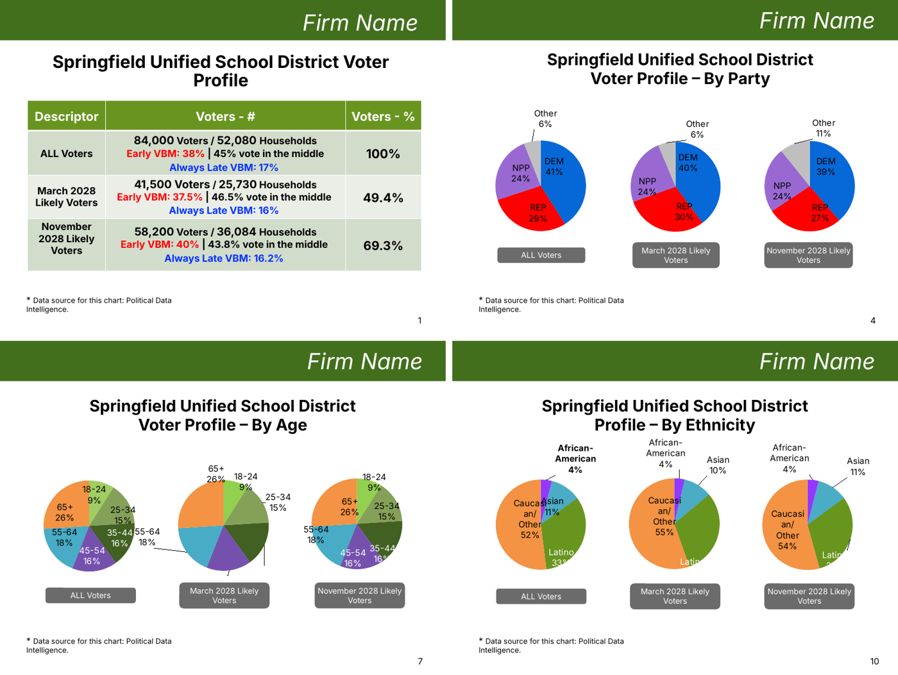

# Voter Profile Deck Generator

Turns a voter-file export from [Political Data Inc. (PDI)](https://www.politicaldata.com/) into a finished, client-ready PowerPoint voter profile: party, age, ethnicity, home ownership and geographic breakdowns for up to three voter universes, in seconds per district.



*Sample output built from synthetic data (`examples/`). Branding is a placeholder.*

## Why I built it

On school-district ballot measure campaigns, every new client starts with the same deck: who is registered, who is likely to vote in each upcoming election, and how they break down. Building one by hand meant copying dozens of figures from a PDI report into 60-plus charts and checking each one. This pipeline does it straight from the raw export and checks its own work.

## What it does

- **Reads the PDI export as-is.** The `.xls` is really an HTML table; it's parsed with the standard library, and labels are normalized so small formatting changes in the export don't break it.
- **Fills a branded template.** Text placeholders like `{{district_name}}` and `{{voters_near}}` are replaced across every slide. Charts are found by shape name (`Near_PartyPie`, `Total_AgeChart`, …) and every copy is updated.
- **Validates before it writes.** Party, age, ethnicity and vote-by-mail segments must reconcile with each universe's total, or no deck is produced. Percentages are computed from counts with half-up rounding, never copied from the report.
- **Tolerates partial data.** If a universe is missing from the file, its charts and text are blanked, slides left empty are removed, and the run summary says exactly what was skipped.
- **Builds geographic pies.** City, unincorporated, council-district and supervisorial-district rows are classified automatically. Anything it doesn't recognize is logged by name instead of guessed.
- **Batch mode.** `watch_folder.py` watches an `inbox/` folder while it's running and turns each dropped export into its own deck, moving the source file to `processed/` or `failed/`.

## Setup

Everything lives in one folder. These steps assume `~/pptx-pipeline`; any location works.

```bash
git clone https://github.com/maximusnobes/pptx-voter-profile.git ~/pptx-pipeline
cd ~/pptx-pipeline
python3 -m venv venv
./venv/bin/pip install -r requirements.txt
```

Try it on synthetic data:

```bash
./venv/bin/python examples/make_sample_export.py
./venv/bin/python populate_pptx.py "examples/Springfield Unified School District.xls"
# -> output/Springfield_Unified_School_District_Voter_Profile_<timestamp>.pptx
```

## Everyday use

1. **Export from PDI.** Pull the voter-profile report for the district as a tabular export (`.xls`).
2. **Rename the file to the district's name**, e.g. `Example Unified School District.xls`. The filename becomes the title on every slide; a raw download name like `report_123.xls` is rejected.
3. **Start the watcher** in Terminal and leave the window open:

   ```bash
   cd ~/pptx-pipeline && ./venv/bin/python watch_folder.py
   ```

4. **Drop the file(s) into `inbox/`.** Once the folder has been quiet for 15 seconds, each file is processed on its own, so several districts can go in at once.
5. **Collect the deck from `output/`.** The source file moves to `processed/`, or to `failed/` with the reason in `output/populate_pptx.log`. Every run also prints a summary of which universes were filled and what was blanked.
6. **Stop the watcher** with `Ctrl+C` when you're done.

For a single file you can skip the watcher:

```bash
cd ~/pptx-pipeline && ./venv/bin/python populate_pptx.py "Example Unified School District.xls"
```

## Configuration

| File | Purpose |
| --- | --- |
| `universes.json` | Which PDI universe code feeds each of the deck's three columns (`total`, `near`, `far`) and what each column is called on the slides. Edit this when the election calendar changes; `alternates` covers transitions between codes. |
| `placeholder_mapping.json` | Reference documentation for every placeholder, chart name and calculation in the template. |
| `template_placeholders.pptx` | The deck template. Swap in your own branding; keep the placeholder text and chart shape names. |

## Project layout

```
populate_pptx.py           parser, validation, chart + text population, run summary
watch_folder.py            inbox watcher for batch runs
universes.json             universe-to-column settings
placeholder_mapping.json   placeholder and chart reference
template_placeholders.pptx deck template (placeholder branding)
examples/                  synthetic export generator, sample input and output
```

## Data and privacy

No real voter data is included. Everything in `examples/` is generated by `make_sample_export.py`, and `inbox/`, `output/`, `processed/`, `failed/` and logs are git-ignored so real exports can't be committed by accident.

## License

MIT
